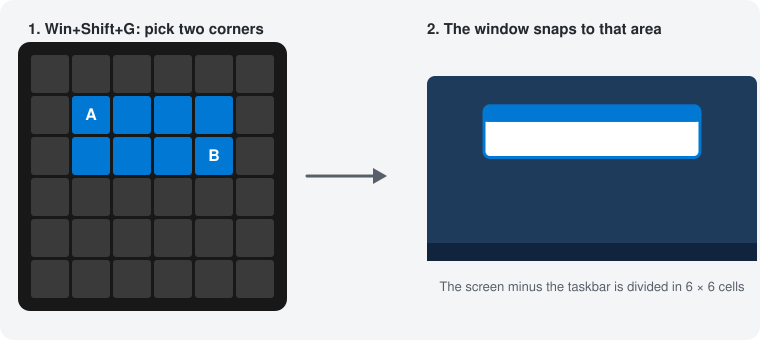

# Tessera

[](https://github.com/echidistanti/tessera/actions/workflows/ci.yml)
[](https://github.com/echidistanti/tessera/releases/latest)
[](LICENSE)

A minimal grid window placer for Windows 10 and 11, inspired by [gTile](https://github.com/gTile/gTile).

Press a shortcut, a semi-transparent grid (6×6 by default) appears in the middle of the screen, pick two corners, and the focused window snaps to that part of the monitor. Tessera is a single small executable that lives in the notification area. It has no windows of its own besides the grid and a small options panel, no configuration files, and no background services.

<p align="center">
  
</p>

## Features

- A 6×6 grid by default, or 3×3, 4×4 or 8×8, drawn on the monitor that holds the focused window.
- Mouse or keyboard selection: hover, click, drag, or use the arrow keys and Space.
- Snaps to the monitor's work area (the screen minus the taskbar), so windows never slide under it.
- Works on multi-monitor setups and with per-monitor DPI scaling.
- Compensates for the invisible borders of Windows 10 and 11 windows, so neighbouring windows meet without gaps.
- Restores a maximized window before moving it.
- A configurable shortcut. The options panel tells you which combinations are already used by Windows or by another program before you pick one.
- Starts with Windows (enabled on first launch, easy to turn off).
- Small: a single executable of under 200 KB, written in Rust on top of plain Win32, with no runtime to install.

## Installation

### Installer (recommended)

1. Download `Tessera-Setup-<version>.exe` from the [latest release](https://github.com/echidistanti/tessera/releases/latest).
2. Run it. No administrator rights are needed: the default is a per-user install in `%LOCALAPPDATA%\Programs\Tessera`. The installer also offers an all-users install.
3. Leave "Start Tessera now" ticked at the end of the wizard.

The installer adds a Start menu entry and an entry in *Settings → Apps*. Installing a newer version over an older one upgrades it in place; a running Tessera is closed automatically.

### Portable

Download `tessera.exe` from the same release page and run it from any folder. Nothing else is needed. On its first launch Tessera turns on *Start with Windows* for the place where the file is. If you move the file later, the entry is updated the next time you start it.

### About the SmartScreen warning

The executables are not code-signed, so Windows SmartScreen shows a warning the first time you run them. Choose **More info → Run anyway**. Each release lists SHA-256 checksums in `SHA256SUMS.txt` if you want to verify your download, and the whole program is in this repository if you prefer to read it or build it yourself.

## Usage

Press **Win+Shift+G**. The grid opens centred on the monitor that holds the focused window, with the highlighted cell on the one where the window's top-left corner currently is.

| Action | Keyboard | Mouse |
| --- | --- | --- |
| Move the highlighted cell | Arrow keys | Hover |
| Set corner A | Space | Click |
| Set corner B and apply | Space again, or Enter | Second click, or drag from A to B |
| Undo corner A, or close the grid | Esc | Right click |

The grid closes after applying, when it loses focus, or when you press the shortcut again.

## The tray icon

| Click | What it does |
| --- | --- |
| Left click | A small menu: **Options…**, **Start with Windows**, **Exit** |
| Right click | The options panel |

### Choosing another shortcut or grid size

Right-click the tray icon to open the options panel.

- Tick any combination of **Win**, **Ctrl**, **Alt** and **Shift**, then pick a key from the list: letters, digits, F1 to F12, Space, Page Up, Page Down, Home, End, Insert and Delete. At least one modifier is required.
- Every key in the list is checked against the modifiers you ticked and marked in colour: normal when the combination is free, red when it is taken, amber when it is free right now but documented as a Windows shortcut. Taken combinations carry a note such as *(used by Windows)*.
- Below the list, a sentence says what applies to your choice, for example *Win+Shift+S is already used by Windows for Snipping Tool.*
- **Save** is disabled while the chosen combination is taken, so you cannot pick one that would not work. **Use defaults** goes back to Win+Shift+G and a 6 × 6 grid.
- **Grid size** offers 3 × 3, 4 × 4, 6 × 6 (the default) and 8 × 8. A coarser grid has fewer, larger cells; a finer one places windows more precisely.
- **Start with Windows** is applied together with the shortcut and the grid size when you press Save.

The new shortcut takes effect immediately and is remembered between runs. If it cannot be registered the next time Tessera starts (another program took it in the meantime), Tessera falls back to Win+Shift+G, then to Win+Ctrl+Alt+G, and says so in a notification. Your choice is kept, and works again as soon as the combination is free.

#### How availability is detected

Windows offers no list of the shortcuts it uses. The only reliable test is to ask Windows to register the combination: if it refuses, the shell or another program already owns it. Tessera does exactly that for every key in the list, releasing each test registration immediately, so nothing is left behind.

Two limits follow from this.

- A refusal tells you that the combination is taken, not by whom. For combinations that Microsoft documents (Win+S, Win+Shift+S, Alt+F4 and so on) Tessera names the feature; for the others it says *Windows or another program*.
- A few combinations, such as Ctrl+Alt+Delete and Win+L, are handled by Windows at a level that programs cannot intercept. Tessera knows them as Windows shortcuts and warns about them in amber even when Windows accepts the registration, because the key press may never arrive.

## Behaviour and limits

- Windows of programs running as administrator cannot be moved by a program that is not elevated. Tessera beeps instead.
- The grid does not open when the desktop or the taskbar has the focus, or when the focused window is hidden or not responding. Tessera beeps.
- The size of a window is set to the chosen area. Programs that enforce a minimum size can end up larger than the area.

## Files and settings

| What | Where |
| --- | --- |
| Log, rewritten at every start | `%LOCALAPPDATA%\Tessera\tessera.log` |
| Chosen shortcut | `HKEY_CURRENT_USER\Software\Tessera` (`HotkeyModifiers`, `HotkeyKey`) |
| Grid size | `HKEY_CURRENT_USER\Software\Tessera` (`GridSize`) |
| First-run flag | `HKEY_CURRENT_USER\Software\Tessera` (`Initialized`) |
| Start with Windows | `HKEY_CURRENT_USER\Software\Microsoft\Windows\CurrentVersion\Run` (`Tessera`) |

The log records the target window, the rectangles involved and the result of every move. If something does not behave, attach it when you [open an issue](https://github.com/echidistanti/tessera/issues).

## Uninstalling

Use *Settings → Apps → Installed apps → Tessera → Uninstall*. The uninstaller closes Tessera and removes the program, the log, the autostart entry and the saved settings.

For the portable version, choose **Exit** from the tray menu, switch *Start with Windows* off first if you want the autostart entry removed, and delete the file.

## Building from source

You need a recent stable [Rust](https://www.rust-lang.org/tools/install) toolchain.

On Windows with the MSVC toolchain:

```powershell
cargo build --release
```

The executable is `target\release\tessera.exe`.

Cross-compiling from Linux:

```sh
rustup target add x86_64-pc-windows-gnu
sudo apt-get install -y gcc-mingw-w64-x86-64
cargo build --release --target x86_64-pc-windows-gnu
```

The executable is `target/x86_64-pc-windows-gnu/release/tessera.exe`.

### Checks

```sh
cargo clippy --release -- -D warnings
cargo test --release
```

The shortcut logic (key names, the list of documented Windows shortcuts, the wording of the status line) lives in `src/combo.rs` and the grid presets in `src/grid.rs`. Neither has a Win32 dependency, so on any platform you can test them on their own, for example with `rustc --test src/combo.rs -o combo_test && ./combo_test`.

### Building the installer

The installer is an [Inno Setup](https://jrsoftware.org/isinfo.php) script. After building the release executable, from the repository root:

```powershell
ISCC.exe /DAppVersion=0.2.0 installer\tessera.iss
```

The result is `dist\Tessera-Setup-0.2.0.exe`.

### Releases

Creating a release for a new tag such as `v0.2.0`, on GitHub or by pushing the tag, runs the [Release workflow](.github/workflows/release.yml) on GitHub Actions. It builds the executable and the installer and attaches `tessera.exe`, the installer and `SHA256SUMS.txt` to the release. If the release does not exist yet, the workflow creates it, using the matching section of [CHANGELOG.md](CHANGELOG.md) as the release notes. The tag must match the version in `Cargo.toml`. *Run workflow* on the Actions page builds everything without publishing, to check the pipeline.

## Project layout

| File | Role |
| --- | --- |
| `src/main.rs` | Startup, single instance, hidden window, message loop, applying the settings |
| `src/hotkey.rs` | Global hotkey registration and the availability test |
| `src/combo.rs` | Shortcut model: keys, labels, documented Windows shortcuts, status wording |
| `src/grid.rs` | Grid size presets |
| `src/options.rs` | The options panel |
| `src/settings.rs` | Saved settings in the registry (shortcut, grid size) |
| `src/overlay.rs` | The grid window: drawing, mouse and keyboard selection |
| `src/placement.rs` | Target validation, grid size and geometry, moving the window |
| `src/tray.rs` | Tray icon, notifications, left-click menu |
| `src/autostart.rs` | Start with Windows (the `Run` key) |
| `src/log.rs`, `src/util.rs` | Logging and helpers |
| `installer/tessera.iss` | Inno Setup script |

## Contributing

Bug reports and pull requests are welcome. For a bug, the contents of `tessera.log` and the Windows version are the most useful things to include. Please keep changes small and in the spirit of the project: Tessera does one thing.

## License

[MIT](LICENSE)
